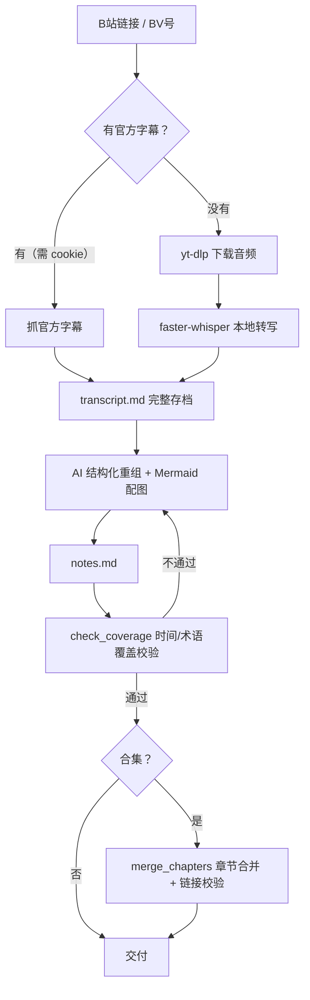

# bili-video-notes

把 B 站视频转成**不丢内容**的结构化 Markdown 学习笔记的 Agent Skill（Claude Code / Kimi Code 等支持 SKILL.md 的 AI 编程助手均可使用）。

核心原则：**笔记是"重组 + 索引"，不是"压缩"**——所有知识点、数据、结论、例子、代码都必须保留，只去掉寒暄和重复，并且有脚本做确定性校验，不是嘴上说说。

## 特点

- **双路转录**：优先抓 B 站官方字幕（秒级）；无字幕时自动降级本地 whisper 转写（faster-whisper，CPU 可跑，有 N 卡自动 CUDA 加速，语言自动检测）
- **防丢内容是机器校验**：每章必须带时间锚点，校验脚本检查笔记是否覆盖整个视频时间轴 + 关键术语，不通过不交付
- **Mermaid 配图**：只看字幕语义生成（mindmap / flowchart / sequenceDiagram / erDiagram），每个节点连线必须能从字幕追溯，拒绝脑补
- **合集工程化**：批量转写（断点续跑）→ 分集笔记 → 按 `chapters.json` 合并章节 → 全量链接校验，分集与章节笔记双向跳转
- **零持续成本**：全程本地免费，无 API key 依赖；音视频只做中转、用完即删，最终只留纯文本
- **有分寸的 UX**：首次使用逐项征得同意后安装工具；之后零打扰；发链接≠转写，意图不明先确认

## 工作流程



## 安装

前置：Python 3.10+、git。Windows 已完整实测；macOS/Linux 理论可行（路径已做兼容，未实测）。

1. 把本仓库克隆到你的 Agent skills 目录（或任意位置）：
   ```bash
   git clone https://github.com/principlesF1rst/bili-video-notes.git
   ```
2. 让 Agent 读取 `SKILL.md`，或直接对它说："帮我装好 bili-video-notes 这个 skill 的环境"。Agent 会先跑：
   ```bash
   python <仓库目录>/scripts/doctor.py
   ```
   然后把缺失项和体积（yt-dlp ≈17MB、ffmpeg ≈190MB、faster-whisper ≈200MB、模型 ≈460MB，均可选/必选项分明）列给你，征得同意后逐项安装到 `<仓库目录>/tools/`（已在 .gitignore 排除，不污染系统）。

## 使用

对 Agent 说即可，例如：

- `把这个视频转成笔记：https://www.bilibili.com/video/BVxxx`
- `把这套教程 P1 到 P88 全部整理成笔记`（批量 + 章节合并）
- `提取这个视频的字幕`

合集产出结构：

```text
<课程目录>/
├── 中间产物/          # 每集 transcript.md + notes.md
├── 笔记/              # 最终章节合并 md（含分集/转录跳转链接）
└── chapters.json      # 章节划分配置（自己维护，可改粒度）
```

`chapters.json` 示例：

```json
{
  "series": "课程名",
  "chapters": [
    { "name": "01-基础篇", "from": 1, "to": 26 },
    { "name": "02-进阶篇", "episodes": [27, 28, 30] }
  ]
}
```

## 配置（都可空，按需）

| 配置 | 位置 | 作用 |
|---|---|---|
| B 站 cookie | `<TOOLS_DIR>/bili_cookie.txt`（写入 SESSDATA 值） | 抓官方字幕必需（B 站字幕不登录拿不到）；不配则全部走 whisper |
| `BILI_NOTE_TOOLS` | 环境变量 | 把工具目录指到 skill 外（如共享工具盘） |
| whisper 模型 | transcribe.py `--model` | 默认 small；base 更快、medium 更准 |
| CUDA | whisper-venv 装 `nvidia-cublas-cu12` + `nvidia-cudnn-cu12` | N 卡加速 3~5 倍，可选 |

## FAQ

- **为什么笔记里没有视频截图/PPT 图？** 刻意取舍：本 skill 只做"字幕语义 → 文字与 Mermaid"，不抽帧、不做视觉识别，换来的是零视觉成本和小体积。PPT 板书为主、口述稀疏的课程，笔记完整性会受限（这类视频建议搭配带画面识别的工具）。
- **转写错字？** whisper 对口语谐音会有误识别，结构化阶段会按上下文修正专业术语；配好 cookie 走官方字幕可完全避免。
- **会留音视频文件吗？** 不会。音频只进缓存目录，转写成功即删；最终产物只有 md。

## License

MIT © principlesF1rst，详见 [LICENSE](LICENSE)。
